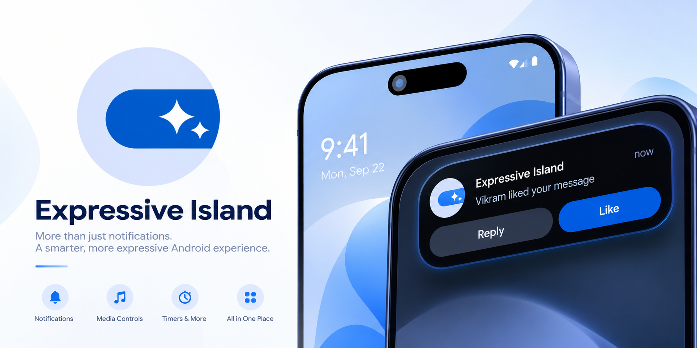

# Expressive Island

**A Material Expressive dynamic island for Android.**

Expressive Island is an actively developed fork of [Expressive Cutout](https://github.com/EvanKoe/expressive-cutout) by [HustleWithVkram](https://github.com/hustlewithVikram).

It transforms the camera cutout on your Android phone into a small, living island for notifications, music, calls, timers, charging events, and other system activity.

Built with **Jetpack Compose** and inspired by Google's **Material Expressive** design language, Expressive Island focuses on expressive animations, flexible customisation, and a polished Dynamic Island experience that feels native to Android.

Expressive Island keeps notification handling and island behaviour on-device. The app requests network access for its in-app updater to check for and download releases; it does not use that access to upload notification content, analytics, or usage data.

---

## Table of contents

* [About](#about)
* [Features](#features)
* [Screenshots](#screenshots)
* [Download](#download)
* [Requirements & Setup](#requirements--setup)
* [Permissions](#permissions)
* [Help with translations](#help-with-translations)
* [Expressive Island vs Original](#expressive-island-vs-original)
* [Original Expressive Cutout](#original-expressive-cutout)
* [Credits & Inspiration](#credits--inspiration)
* [License](#license)

---

# About

Expressive Island is a community-driven continuation of the original **Expressive Cutout** project.

The project takes the original foundation and continues development under a new identity, with room for new features, improvements, bug fixes, experiments, and Android-specific enhancements.

The goal is simple:

> **Make Android's camera cutout feel like a useful, expressive part of the interface instead of just a hole in the screen.**

Notifications can appear directly around the cutout, while live tiles provide quick access to information such as:

* Currently playing music
* Active phone calls
* Incoming calls
* Running timers
* Charging state
* Battery warnings
* Wi-Fi changes
* Headphone connections
* USB connections
* Device unlock events

Everything is designed around Material Expressive shapes, motion, colours, and customisation.

---

# Features

| Category                | Features                                                                                                                                                                                 |
| ----------------------- | ---------------------------------------------------------------------------------------------------------------------------------------------------------------------------------------- |
| **Notifications**       | Mirrors notifications in the island · notification icons · automatic expansion · title and text · compact icon-only mode · notification actions · inline replies · swipe-to-dismiss      |
| **Music**               | Song title and artist · album artwork · optional spinning artwork · playback state · previous / play-pause / next controls                                                               |
| **Phone calls**         | Caller name · contact photo · live call duration · hang-up action · incoming call interface · answer / decline actions · open in-call screen · optional two-row incoming-call layout     |
| **Timers**              | Live countdown from the clock app · Android 16+ live-update timer support · real clock-app actions · Add 1 min · Reset · Pause / Resume state                                            |
| **System events**       | Charging started / stopped · low battery · Wi-Fi connected / disconnected · headphones connected / disconnected · USB connected / removed · device unlocked                              |
| **Event customisation** | Material icons · icon search · animated icons · animation looping · individual colours · event duration · Material You colours                                                           |
| **Island sizing**       | Independent normal / expanded width · independent normal / expanded height · corner radius controls · per-corner radius · horizontal position · vertical position                        |
| **Appearance**          | Solid backgrounds · gradients · gradient direction · opacity · shadows · outline stroke · custom stroke colour · Material You colours · preset colours · custom HEX colours              |
| **Themes**              | Light · dark · system                                                                                                                                                                    |
| **Action buttons**      | Expressive tonal · Expressive filled · Material You · outlined styles · multiple reply-field styles · button height · button colours · cancel button positioning · tile-specific colours |
| **Animations**          | Expressive spring · ease-in-out · slow / default / fast speeds · bounce size · configurable animation duration                                                                           |
| **Gestures**            | Auto-collapse · persistent expanded state · swipe up to shrink · swipe sideways to dismiss · configurable dismiss direction · configurable size behaviour                                |
| **Lockscreen**          | Optional complete island removal on the lockscreen to ensure the overlay is torn down when hidden                                                                                        |
| **Privacy**             | On-device notification handling · updater network access only · no analytics · no tracking · no upload of notification content or usage data                                               |
| **Testing**             | Test notifications · notification actions · inline replies · test ongoing calls · test incoming calls · system-event previews                                                            |

---

# Screenshots

| Screenshot 1 | Screenshot 2 | Screenshot 3 |
|:---:|:---:|:---:|
|  |  |  |
| Screenshot 4 | Screenshot 5 | Screenshot 6 |
|  |  |  |
| Screenshot 7 |  |  |
|  |  |  |

---

# Download

### Android requirements

Expressive Island requires:

* **Android 10 (API 29) or newer**
* Notification access
* Accessibility service
* Optional battery optimisation exemption

On first launch, Expressive Island guides you through the permissions required for the island to work.

### Releases

Get the latest builds from the project's GitHub releases:

**[Expressive Island Releases](https://github.com/hustlewithvikram/expressive-island/releases)**

### Source code

The complete source code is available here:

**[Expressive Island on GitHub](https://github.com/hustlewithvikram/expressive-island)**

---

# Requirements & Setup

After installing Expressive Island, the app will guide you through the required setup.

### 1. Notification access

Required to mirror notifications into the island.

### 2. Accessibility service

Used to display the island as an overlay above other applications.

Expressive Island does **not** use the accessibility service to read your screen contents.

### 3. Battery optimisation

Optional, but recommended.

Some Android manufacturers aggressively terminate background applications. Allowing Expressive Island to ignore battery optimisation can improve reliability.

---

# Permissions

Expressive Island intentionally keeps its permissions to a minimum.

| Permission                      | Purpose                                                       |
| ------------------------------- | ------------------------------------------------------------- |
| **Notification access**         | Reads notifications so they can be displayed and interacted with in the island |
| **Accessibility service**       | Displays the island overlay and handles island gestures; it does not read screen contents |
| **Ignore battery optimisation** | Optional; helps prevent the overlay service from being stopped in the background |
| **Post notifications**          | Optional; posts test notifications when you explicitly trigger a test |
| **Internet**                    | Checks for and downloads app updates through the in-app updater |
| **Request install packages**    | Lets the updater open Android's installer for a downloaded APK; installation still requires confirmation |
| **Network state**               | Reads connection state for Wi-Fi/network events |
| **Wi-Fi state**                 | Reads Wi-Fi state and details needed by the Wi-Fi event tile |
| **Nearby Wi-Fi devices**        | Supports Wi-Fi APIs on Android 13+; marked `neverForLocation` |
| **Bluetooth connect / scan**    | Supports Bluetooth connection-state events; scan permission is marked `neverForLocation` |
| **Fine / approximate location** | Legacy compatibility for older Wi-Fi APIs; not used to record or track location |
| **Vibration**                   | Provides haptic feedback |
| **Shizuku API**                 | Declares optional integration with compatible Shizuku versions |

### Privacy

Expressive Island requests `INTERNET` access only for its in-app updater, which checks for and downloads app releases. The app does not upload notification content or usage analytics. Notification content is handled locally for display and is not sent to the updater.

The app also declares `REQUEST_INSTALL_PACKAGES` so the updater can hand a downloaded APK to Android's package installer. Android still requires you to confirm installation.

---

# Expressive Island vs Original

Expressive Island is a **fork**, not an independent project created from scratch.

It is based on the original work of **EvanKoe's Expressive Cutout**.

The original project provided the foundation for the Dynamic Island experience, including much of the original:

* Material Expressive design
* Notification handling
* Overlay architecture
* System events
* Music tile
* Phone tile
* Timer tile
* Animation system
* Customisation system
* Permission flow

Expressive Island exists to continue development from that foundation.

The fork may introduce changes, fixes, redesigns, experimental functionality, and features that differ from the original project.

---

# Original Expressive Cutout

## Created by EvanKoe

**Expressive Cutout** is the original project from which Expressive Island was forked.

The original project introduced the idea of an offline Android dynamic island built around Google's Material Expressive design language.

### Original project

**GitHub:**
https://github.com/EvanKoe/expressive-cutout

**Releases:**
https://github.com/EvanKoe/expressive-cutout/releases

**Issues:**
https://github.com/EvanKoe/expressive-cutout/issues

**Stars:**
https://github.com/EvanKoe/expressive-cutout/stargazers

**Author:**
https://github.com/EvanKoe

### Original Discord community

The original project also has a Discord community for feedback, feature requests, bug reports, discussion, and sharing:

https://discord.gg/SNfcuuJeYF

If you are looking for the original project, its original releases, or its original community, please use the links above.

---

# Credits & Inspiration

Expressive Island would not exist without the work that came before it.

## Original project

Special thanks to **EvanKoe** for creating Expressive Cutout and providing the foundation on which Expressive Island is built.

**Original repository:**
https://github.com/EvanKoe/expressive-cutout

## Inspiration

The project was also inspired by other Android applications and open-source projects, particularly in terms of Dynamic Island concepts, UI, and Material Expressive design.

### Dynamic Spot

https://play.google.com/store/apps/details?id=com.jamworks.dynamicspot&hl=en

### Material Capsule

https://play.google.com/store/apps/details?id=com.pryshedko.mtisland&hl=en

### Sameerasw's Essential

Special thanks to [Sameerasw's Essential](https://github.com/sameerasw/essentials) for its excellent Material You Expressive implementation.

It has been a major source of inspiration for the visual direction and design language of this project.

---

# Development

Expressive Island is developed as an open-source project.

Contributions, bug reports, feature requests, testing, and feedback are welcome.

### GitHub

**Repository:**
https://github.com/hustlewithvikram/expressive-island

**Issues:**
https://github.com/hustlewithvikram/expressive-island/issues

**Pull requests:**
https://github.com/hustlewithvikram/expressive-island/pulls

**Releases:**
https://github.com/hustlewithvikram/expressive-island/releases

**Discussions:**
https://github.com/hustlewithvikram/expressive-island/discussions

---

# Help with translations

Expressive Island currently includes **English, Hindi, and Marathi**. Would you like to help make the app accessible to more people? Contributions to improve existing translations or add another language are welcome.

- Browse the app's string resources in [`app/src/main/res/values/strings.xml`](app/src/main/res/values/strings.xml).
- Use the existing locale folders such as [`values-hi`](app/src/main/res/values-hi) and [`values-mr`](app/src/main/res/values-mr) as examples when adding or updating a translation.
- Keep every string resource name unchanged, preserve formatting placeholders such as `%1$s` and `%d`, and escape XML characters correctly.
- Test the app with the contributed language before opening a pull request.

Not sure where to start? Open an issue or pull request and mention the language you'd like to help with. Even small corrections are useful.

---

# License

Expressive Island is free software licensed under the **GNU General Public License v3.0**.

You may:

* Use the software
* Study the source code
* Modify the software
* Share the software
* Distribute modified versions

Any distributed derivative must remain under the same licence.

Because Expressive Island is a fork of Expressive Cutout, the original project's licensing and attribution requirements must also be respected.

See the [LICENSE](LICENSE) file for the complete terms.

---

**Expressive Island**

*An open-source, offline, Material Expressive dynamic island for Android.*

Built on the foundation of **Expressive Cutout by EvanKoe**.

[GitHub](https://github.com/hustlewithvikram/expressive-island) · [Releases](https://github.com/hustlewithvikram/expressive-island/releases) · [Issues](https://github.com/hustlewithvikram/expressive-island/issues)

