

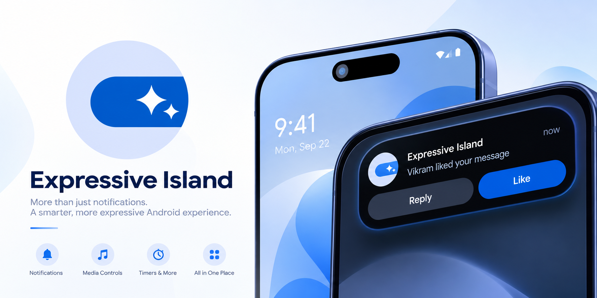

# Expressive Island

**A Material Expressive dynamic island for Android.**

Expressive Island turns your phone's camera cutout into a live area for notifications, music, calls, timers, and system events. Built with Jetpack Compose, it is a community-developed fork of [Expressive Cutout](https://github.com/EvanKoe/expressive-cutout), focused on customisation, smooth animations, and an Android-native feel.

Notification content is handled on-device. Internet access is used by the in-app updater to check for and download updates, not to upload notification content or usage analytics.

---

## Table of contents

* [About](#about)
* [Features](#features)
* [Screenshots](#screenshots)
* [Download](#download)
* [Permissions](#permissions)
* [Help with translations](#help-with-translations)
* [Credits & Inspiration](#credits--inspiration)
* [FAQ](#faq)
* [License](#license)

---

# About

Expressive Island is a community-driven continuation of the original **Expressive Cutout** project.

The project takes the original foundation and continues development under a new identity, with room for new features, improvements, bug fixes, experiments, and Android-specific enhancements.

The goal is simple:

> **Make Android's camera cutout feel like a useful, expressive part of the interface instead of just a hole in the screen.**

Everything is designed around Material Expressive shapes, motion, colours, and customisation.

---

# Features

| Category                | Features                                                                                                                                                                                 |
| ----------------------- | ---------------------------------------------------------------------------------------------------------------------------------------------------------------------------------------- |
| **AI Assistant**       | Interactive text and voice assistant · configurable AI provider and model · chat history · streaming responses · custom API support |
| **Notifications**       | Mirrors notifications in the island · notification icons · automatic expansion · title and text · compact icon-only mode · notification actions · inline replies · swipe-to-dismiss      |
| **Music**               | Song title and artist · album artwork · optional spinning artwork · playback state · previous / play-pause / next controls                                                               |
| **Phone calls**         | Caller name · contact photo · live call duration · hang-up action · incoming call interface · answer / decline actions · open in-call screen · optional two-row incoming-call layout     |
| **Timers**              | Live countdown from the clock app · Android 16+ live-update timer support · real clock-app actions · Add 1 min · Reset · Pause / Resume state                                            |
| **System events**       | Charging started / stopped · low battery · Wi-Fi connected / disconnected · headphones connected / disconnected · USB connected / removed · device unlocked                              |
| **Event customisation** | Material icons · icon search · animated icons · animation looping · individual colours · event duration · Material You colours                                                           |
| **Island sizing**       | Independent normal / expanded width · independent normal / expanded height · corner radius controls · per-corner radius · horizontal position · vertical position                        |
| **Appearance**          | Solid backgrounds · gradients · gradient direction · opacity · shadows · outline stroke · custom stroke colour · Material You colours · preset colours · custom HEX colours              |
| **Themes**              | Light · dark · system                                                                                                                                                                    |
| **Action buttons**      | Expressive tonal · Expressive filled · Material You · outlined styles · multiple reply-field styles · button height · button colours · cancel button positioning · tile-specific colours |
| **Animations**          | Expressive spring · ease-in-out · slow / default / fast speeds · bounce size · configurable animation duration                                                                           |
| **Gestures**            | Auto-collapse · persistent expanded state · swipe up to shrink · swipe sideways to dismiss · configurable dismiss direction · configurable size behaviour                                |
| **Lockscreen**          | Optional complete island removal on the lockscreen to ensure the overlay is torn down when hidden                                                                                        |
| **Privacy**             | On-device notification handling · updater network access only · no analytics · no tracking · no upload of notification content or usage data                                               |
| **Testing**             | Test notifications · notification actions · inline replies · test ongoing calls · test incoming calls · system-event previews                                                            |

---

# Screenshots

| Screenshot 1 | Screenshot 2 | Screenshot 3 |
|:---:|:---:|:---:|
| 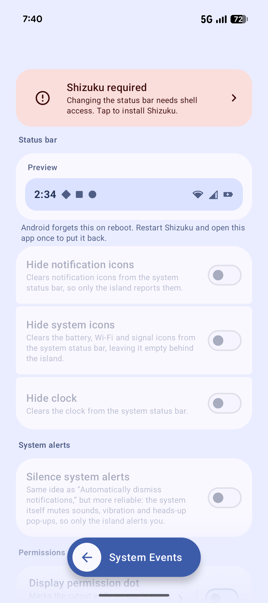 |  | 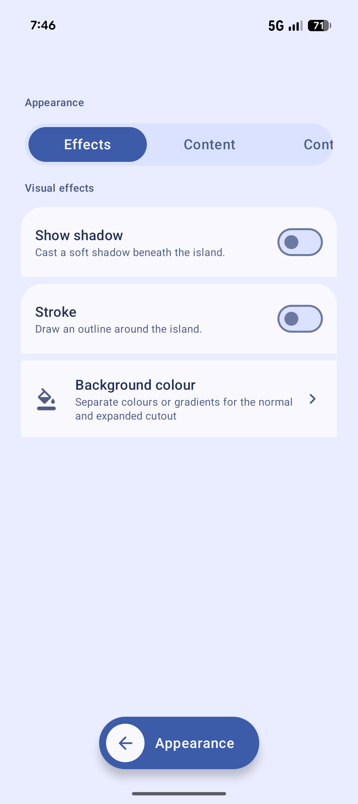 |
| 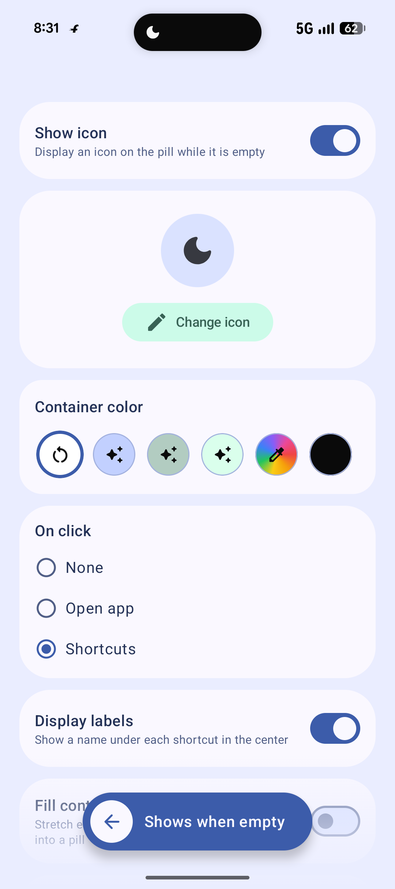 | 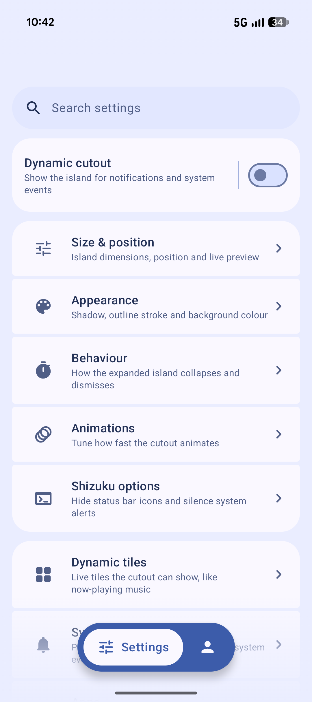 | 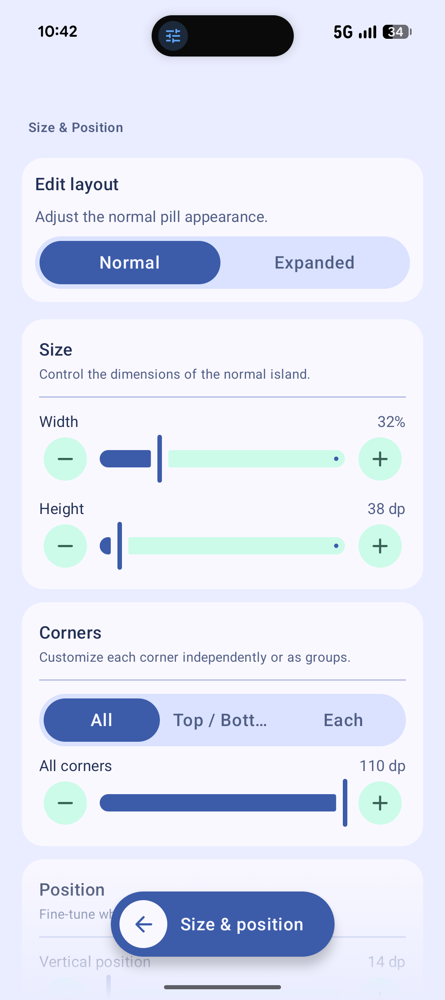 |
| 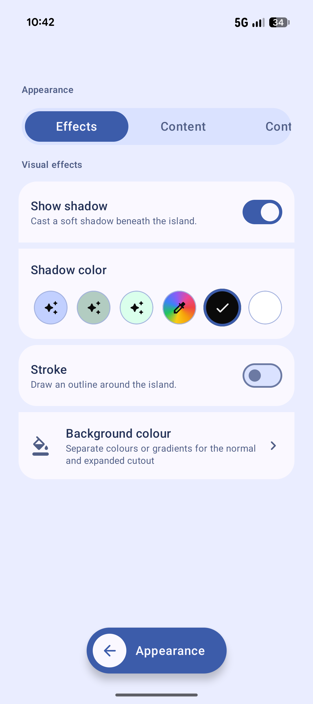 | 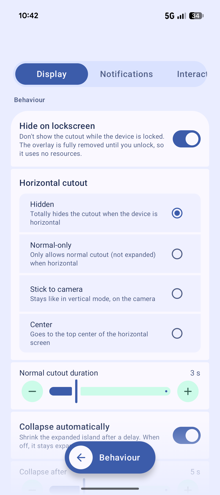 | 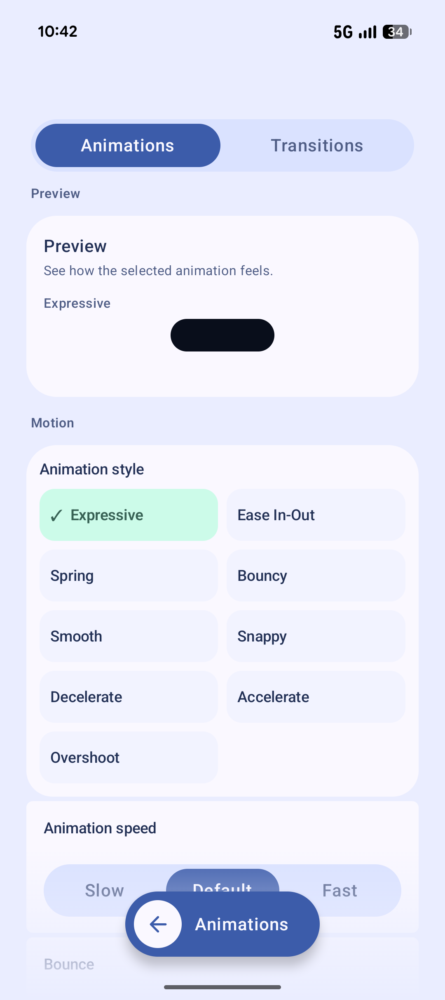 |
| 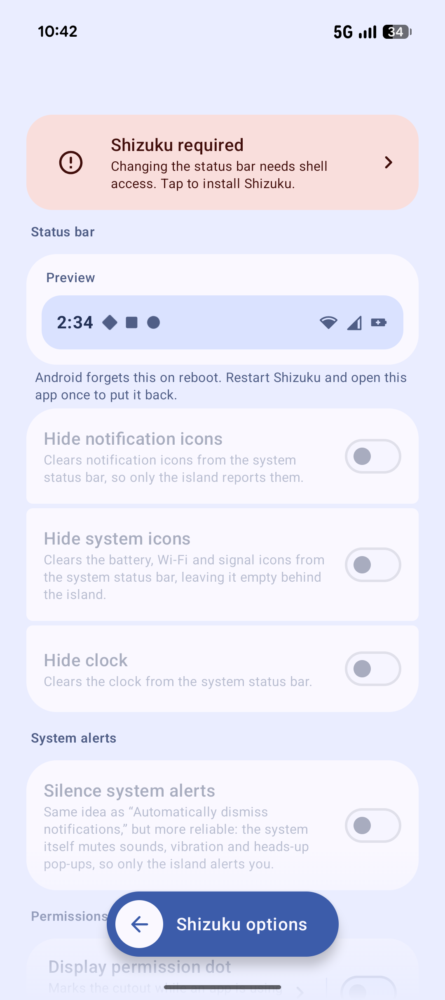 | 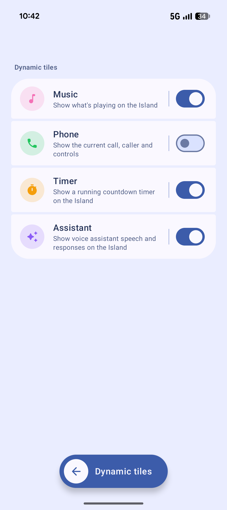 | 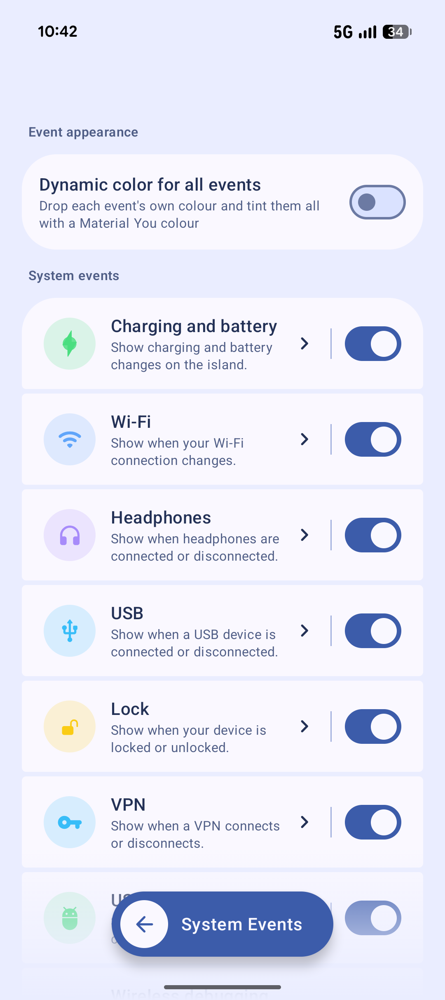 |
| 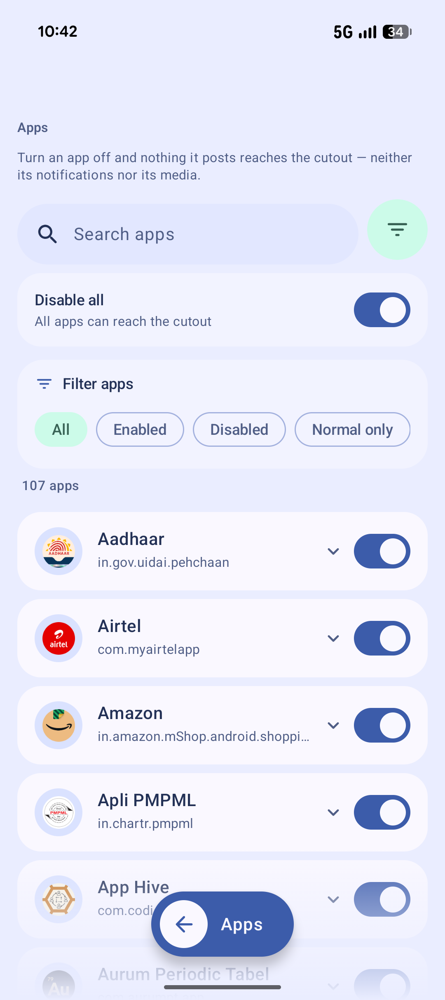 | 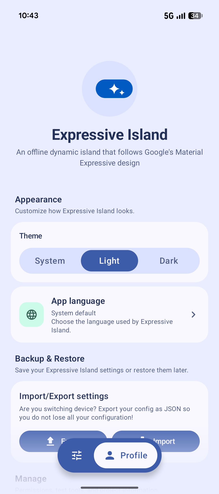 | 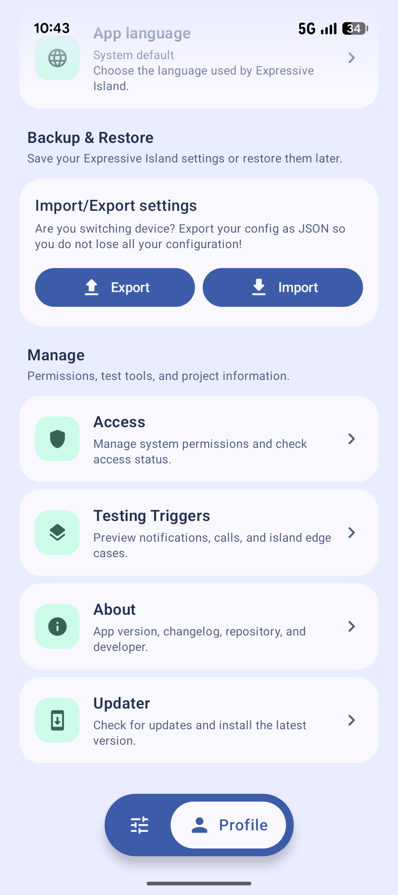 |

---

# Download

Two build types are available on the [Releases page](https://github.com/hustlewithvikram/expressive-island/releases):

- **Stable release:** The recommended release build for everyday use.
- **Debug build:** A development/nightly-style build generated after commits to the `dev` and `main` branches. It may contain work in progress and is intended for testing.

# Android requirements

Expressive Island requires:

* **Android 10 (API 29) or newer**
* Notification access
* Accessibility service
* Optional battery optimisation exemption

On first launch, Expressive Island guides you through the permissions required for the island to work.

---

# Using the AI Assistant

Connect an AI provider once, then use the Assistant tile to chat.

1. **Get an API key** from your provider (for example, [OpenAI](https://platform.openai.com/api-keys), [Google AI Studio](https://aistudio.google.com/app/apikey), [Anthropic](https://console.anthropic.com/settings/keys), [Groq](https://console.groq.com/keys) or [OpenRouter](https://openrouter.ai/keys)). API access and usage may be billed separately by the provider.
2. Open **Settings → Integrations → AI Assistant** in Expressive Island.
3. Select your provider, choose a model, and paste its API key. For **Custom API**, also enter the base URL of your OpenAI-compatible endpoint.
4. Your provider, model and key are saved locally. The API key is encrypted using Android Keystore.
5. Open **Settings → Assistant**, select **Manual** mode, then go to **Settings → Behaviour → Camera Hole Touch**. Enable camera-hole touch and choose **App Assistant** as its action.
6. Tap the camera-hole area to open the Assistant tile, type a message or use the microphone, and send it. Your configured provider generates the response.

You can change response length, creativity, streaming and conversation context under **Integrations → AI Assistant**. Keep your API key private; never share it or include it in screenshots.

---

# Permissions

Expressive Island intentionally keeps its permissions to a minimum.

| Permission                      | Purpose                                                       |
| ------------------------------- | ------------------------------------------------------------- |
| **Notification access**         | Reads notifications so they can be displayed and interacted with in the island |
| **Accessibility service**       | Displays the island overlay and handles island gestures; it does not read screen contents |
| **Ignore battery optimisation** | Optional; helps prevent the overlay service from being stopped in the background |
| **Post notifications**          | Optional; posts test notifications when you explicitly trigger a test |
| **Internet**                    | Checks for and downloads app updates through the in-app updater |
| **Request install packages**    | Lets the updater open Android's installer for a downloaded APK; installation still requires confirmation |
| **Network state**               | Reads connection state for Wi-Fi/network events |
| **Wi-Fi state**                 | Reads Wi-Fi state and details needed by the Wi-Fi event tile |
| **Nearby Wi-Fi devices**        | Supports Wi-Fi APIs on Android 13+; marked `neverForLocation` |
| **Bluetooth connect / scan**    | Supports Bluetooth connection-state events; scan permission is marked `neverForLocation` |
| **Fine / approximate location** | Legacy compatibility for older Wi-Fi APIs; not used to record or track location |
| **Vibration**                   | Provides haptic feedback |
| **Shizuku API**                 | Declares optional integration with compatible Shizuku versions |

# Privacy

Expressive Island requests `INTERNET` access only for its in-app updater, which checks for and downloads app releases. The app does not upload notification content or usage analytics. Notification content is handled locally for display and is not sent to the updater.

The app also declares `REQUEST_INSTALL_PACKAGES` so the updater can hand a downloaded APK to Android's package installer. Android still requires you to confirm installation.

---

# Credits & Inspiration

Thanks to **[EvanKoe](https://github.com/EvanKoe)** for creating [Expressive Cutout](https://github.com/EvanKoe/expressive-cutout), the foundation of this project. Design inspiration also comes from [Dynamic Spot](https://play.google.com/store/apps/details?id=com.jamworks.dynamicspot), [Material Capsule](https://play.google.com/store/apps/details?id=com.pryshedko.mtisland), and [Sameerasw's Essentials](https://github.com/sameerasw/essentials), especially its Material You Expressive design.

---

# Development

Contributions, bug reports, feature requests, testing, and feedback are welcome. If you would like to contribute, open an issue or submit a pull request.

---

# Help with translations

Expressive Island currently includes **English, Hindi, and Marathi**. Would you like to help make the app accessible to more people? Contributions to improve existing translations or add another language are welcome.

- Browse the app's string resources in [`app/src/main/res/values/strings.xml`](app/src/main/res/values/strings.xml).
- Use the existing locale folders such as [`values-hi`](app/src/main/res/values-hi) and [`values-mr`](app/src/main/res/values-mr) as examples when adding or updating a translation.
- Keep every string resource name unchanged, preserve formatting placeholders such as `%1$s` and `%d`, and escape XML characters correctly.
- Test the app with the contributed language before opening a pull request.

Not sure where to start? Open an issue or pull request and mention the language you'd like to help with. Even small corrections are useful.

---

# FAQ

What is Expressive Island?

Expressive Island is an Android dynamic island app that brings notifications, media controls, calls, timers, and system events around your device's camera cutout.

Which Android versions are supported?

Expressive Island requires Android 10 (API 29) or newer.

Why does the app need Notification access?

Notification access lets Expressive Island display notifications and provide supported notification actions inside the island.

Why does the app need Accessibility service access?

The accessibility service is used to display the island overlay and handle its interactions. It does not read your screen contents.

What is the difference between Stable and Debug builds?

Stable builds are recommended for everyday use. Debug builds are development/nightly-style builds generated after commits to the `dev` and `main` branches and may include unfinished changes. Both are available on the [Releases page](https://github.com/hustlewithvikram/expressive-island/releases).

How do I use the AI Assistant?

Add your AI provider's API key under **Settings → Integrations → AI Assistant**, select a provider and model, then open the Assistant tile. See [Using the AI Assistant](#using-the-ai-assistant) for setup steps.

Is my notification data uploaded?

No. Notification content is handled locally on your device. Internet access is used by the in-app updater to check for and download releases.

Where can I report a bug or request a feature?

Open an [Issue](https://github.com/hustlewithvikram/expressive-island/issues) and include your Android version, device model, and steps to reproduce the issue.

How can I contribute or help with translations?

Contributions are welcome. You can submit a pull request, report issues, or help improve the English, Hindi, and Marathi translations.

---

# License

Expressive Island is free software licensed under the **GNU General Public License v3.0**.

You may:

* Use the software
* Study the source code
* Modify the software
* Share the software
* Distribute modified versions

Any distributed derivative must remain under the same licence.

Because Expressive Island is a fork of Expressive Cutout, the original project's licensing and attribution requirements must also be respected.

See the [LICENSE](LICENSE) file for the complete terms.

---

**Expressive Island**

*An open-source, Material Expressive dynamic island for Android.*

